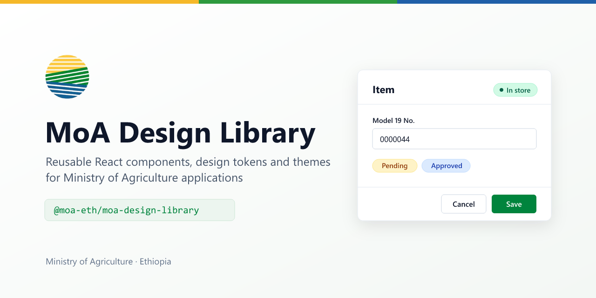

# MoA Design Library



Reusable React components, design tokens and themes for Ministry of Agriculture (MoA) applications.
One package — `@moa-eth/moa-design-library` — so every MoA system looks and behaves the same.

- React 18 and 19, TypeScript types included
- Built on Radix UI and Tailwind CSS 4, with semantic theme tokens
- Accessible by default: labels, keyboard use and screen-reader text are part of each component
- Themes: the MoA default (MoA green, national gold) and a dark mode; teams can add their own

## Install

The package is published to GitHub Packages. GitHub Packages asks for a token to install any package, public ones included.

1. Create a GitHub personal access token with `read:packages`.
2. In your app, add an `.npmrc`:

   ```ini
   @moa-eth:registry=https://npm.pkg.github.com
   //npm.pkg.github.com/:_authToken=${GITHUB_TOKEN}
   ```

3. Install:

   ```bash
   pnpm add @moa-eth/moa-design-library
   # or: npm install @moa-eth/moa-design-library
   ```

## Use

Load the styles once, at your app's entry:

```tsx
import '@moa-eth/moa-design-library/styles.css';
```

Then import components by name:

```tsx
import { Button, Card, Chip, Input } from '@moa-eth/moa-design-library';

export function Example() {
  return (
    <Card title="Item" actions={<Chip tone="success">In store</Chip>}>
      <Input label="Model 19 No." />
      <Button>Save</Button>
    </Card>
  );
}
```

Dark mode: add the `dark` class to `<html>`. Another theme: load its file after the styles,
e.g. `import '@moa-eth/moa-design-library/themes/default.css'`.

## Import contract

Import only from these entry points:

| What        | From                                            |
| ----------- | ----------------------------------------------- |
| Components  | `@moa-eth/moa-design-library`                   |
| Styles      | `@moa-eth/moa-design-library/styles.css`        |
| Theme files | `@moa-eth/moa-design-library/themes/<name>.css` |

Never import from `dist/` or `src/`: those paths can change in any release.

## Components

| Component | For                                                           |
| --------- | ------------------------------------------------------------- |
| Button    | Actions; links styled as buttons                              |
| Input     | Text fields with label, hint and error                        |
| Chip      | Short status labels (In store, Pending, Rejected)             |
| Card      | Panels with a title, description, header actions and a footer |

Details in [docs/COMPONENTS.md](docs/COMPONENTS.md); theming in [docs/THEMING.md](docs/THEMING.md);
how the library is built in [docs/ARCHITECTURE.md](docs/ARCHITECTURE.md); how to contribute in
[docs/CONTRIBUTING.md](docs/CONTRIBUTING.md). AI coding tools read [AGENTS.md](AGENTS.md) and `ai/contracts`.

## Develop

```bash
pnpm install
pnpm test        # unit tests
pnpm lint        # lint
pnpm typecheck   # types
pnpm build       # dist/ with components, types, styles.css and themes
```

## License

[MIT](LICENSE) © Ministry of Agriculture, Federal Democratic Republic of Ethiopia
